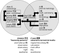
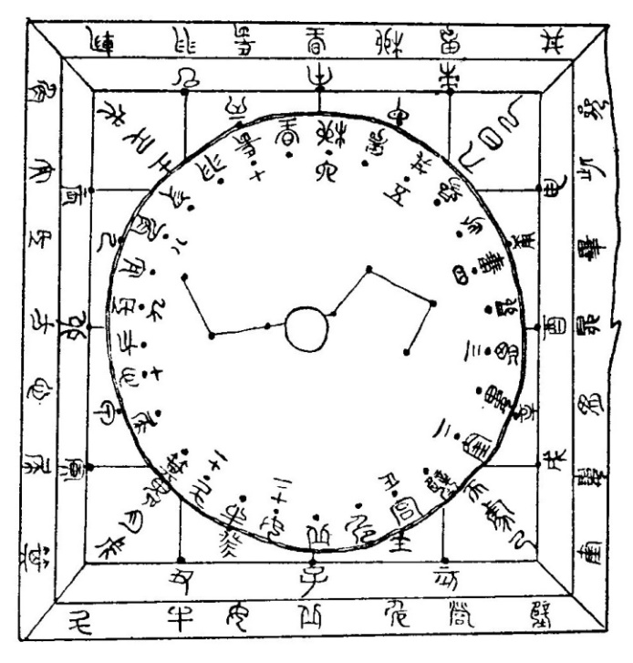

# Introduction

Dans la préface d'un traité de calcul astronomique datant de 85 apr. J.-C., le _Sifen li_ 四分曆, les auteurs s'attachent, de manière assez conventionnelle, à montrer que leurs calculs reposent à la fois sur l'observation des phénomènes célestes et sur l'autorité des textes anciens. Ils concluent toutefois en insistant sur la portée morale de leur entreprise.

<!-- slide 1: Sifen li — préface -->

> 夫曆有聖人之德六焉：以本氣者尚其體，以綜數者尚其文，以考類者尚其象，以作事者尚其時，以占往者尚其源，以知來者尚其流。
> Le _li_ 曆 (astronomie mathématique) possède six vertus propres au sage : en prenant les souffles pour fondement, il honore la substance ; en combinant les nombres, il honore les configurations ; en examinant les catégories, il honore les figures ; en ordonnant les activités, il honore les moments opportuns ; en interprétant le passé, il honore les origines ; en connaissant l'avenir, il honore le cours des choses.
> 
> 大業載之，吉凶生焉，是以君子將有興焉，咨焉而以從事，受命而莫之違也。
> Ce grand héritage de devoirs en est le dépositaire, et de lui procèdent le faste et le néfaste. Aussi, lorsqu'un homme de bien s'apprête à entreprendre quelque chose, la consulte-t-il pour régler sa conduite ; il se conforme à ses prescriptions et ne saurait y contrevenir.
> 
> 若夫用天因地，揆時施教，頒諸明堂，以為民極者，莫大乎月令。帝王之大司備矣，天下之能事畢矣。
> Quant à se servir du Ciel et à prendre appui sur la Terre, à déterminer les saisons et à promulguer les enseignements qui leur correspondent, à les faire connaître dans le Hall de lumière (_mingtang_ 明堂) afin d'établir une norme pour le peuple, rien ne surpasse en cela les Ordonnances mensuelles (« Yueling » 月令). Elles embrassent l'ensemble des grandes fonctions du souverain et épuisent tout ce qu'il est possible d'accomplir dans l'empire.
> 
> 過此而往，羣忌苟禁，君子未之或知也。
> Au-delà de ces limites, l'homme de bien ignore la multitude des tabous et des prohibitions arbitraires (l'hémérologie)[^1].

<!-- /slide -->

Pour résumer, le **_li_ 曆** — l'astronomie mathématique — y apparaît comme l'héritier de six vertus des **sages** de la Haute Antiquité[^2] : l'appréhension de l'ordre du cosmos, la régulation des activités agricoles et rituelles, la reconstitution du passé et la prévision de l'avenir. Il participe ainsi au maintien de l'ordre cosmique et politique, tout en contribuant à la formation morale de **l'homme de bien**[^3]. Les auteurs ajoutent toutefois une précision remarquable : « Au-delà de cela, l'homme de bien ne connaît rien à la multitude des interdits et des prohibitions arbitraires », une allusion à **l'hémérologie**[^4].

Le corps du _Sifen li_ est une succession d'algorithmes sèche et convenue. Mais sa préface révèle une tension intéressante : le calcul du calendrier et la divination calendaire sont deux pratiques bien distinctes, qui se ressemblent pourtant en apparence. Les auteurs éprouvent donc le besoin de les différencier. Pourquoi ? Parce le premier est indispensable à l'ordre du monde et de la société, tandis que la seconde menace de l'entraver.

[^1]: _Sifen li_, cité dans _Hou Hanshu_ 後漢書 (éd. Zhonghua shuju), _zhi_ 3, p. 3057 ([Ctext](https://ctext.org/hou-han-shu/lv-li-xia?searchu=%E5%90%9B%E5%AD%90%E6%9C%AA%E4%B9%8B%E6%88%96%E7%9F%A5%E4%B9%9F&searchmode=showall#result)) ; voir la traduction complète dans Christopher Cullen, _The Foundations of Celestial Reckoning: Three Ancient Chinese Astronomical Systems_, Scientific Writings from the Ancient and Medieval World (Routledge, 2017).  

[^2]: **Def. :** « les sages » (_sheng_ 聖) : figures exemplaires de l'Antiquité chinoise, notamment les « rois sages », auxquelles la tradition attribue la fondation des institutions, des savoirs et des principes de la civilisation.

[^3]: **Def. :** « l'homme de bien » (_junzi_ 君子) : idéal moral du lettré dans la tradition confucéenne, caractérisé par sa vertu, son discernement et sa conduite exemplaire.

[^4]: **Def. :** « l'hémérologie » (*ri* 日, _xuanze_ 選擇, etc.) : l'ensemble de techniques divinatoires visant à déterminer les jours et les moments favorables ou défavorables à différentes activités humaines. Sur l'hémérologie chinoise, voir Donald Harper et Marc Kalinowski, éd., _Books of Fate and Popular Culture in Early China: The Daybook Manuscripts of the Warring States, Qin, and Han_ (Brill, 2017).

# Catégories (6:00)

La langue chinoise a beaucoup évolué depuis, et les termes qui préoccupaient tant les auteurs du _Sifen li_ n'existent plus tout à fait dans le même sens. Il s'agit donc de catégories dites _émiques_, ou « catégories des acteurs ». Au Ier siècle apr. J.-C., elles formaient déjà un ensemble relativement **complet** et **stable**, qui structurait les **bibliothèques**, l'historiographie et la bureaucratie impériale.

Sur le plan **bibliographique**, _L'Histoire des Han_ (_Hanshu_ 漢書), achevée en 111 apr. J.-C., conserve un catalogue de la bibliothèque impériale, organisé selon une véritable taxonomie des savoirs, cohérente et fort différente de celle de la BnF. Les savoirs qui nous intéressent sont regroupés sous deux grandes rubriques, divisées en dix sous-catégories[^5]. Les auteurs du _Sifen li_ tenaient précisément à distinguer les pratiques correspondant aux deuxième et troisième lignes du **Tableau 1**.

[^5]: Sur les bibliothèques, les bibliographies et la classification textuelle en Chine ancienne, voir Jean Pierre Drège, _Les bibliothèques en Chine au temps des manuscrits: jusqu’au Xe siècle_, Publications de l’École française d’Extrême-Orient 161 (École française d’Extrême-Orient, 1991). Sur la classification des savoirs techniques du point de vue d'un historien des sciences, voir Nathan Sivin, « Science and Medicine in Chinese History », in _Heritage of China: Contemporary Perspectives on Chinese Civilization_, éd. par Paul S. Ropp (University of California Press, 1990). Du point de vue d'un historien de la divination, voir Marc Kalinowski, « Technical Traditions in Ancient China and _Shushu_ Culture in Chinese Religion », in _Religion and Chinese Society_, éd. par John Lagerwey (The Chinese University Press; Paris: École française d’Extrême-Orient, 2004).

<!-- slide 2: Tableau 1 — taxonomie des savoirs -->

| Catégorie principale                   | Sous-catégorie   | Traduction / Description                                               |
| -------------------------------------- | ---------------- | ---------------------------------------------------------------------- |
| 術數 (*shushu*) — Procédures et nombres  | 天文 (*tianwen*)   | Signes célestes                                                        |
|                                        | 曆譜 (*lipu*)      | Astronomie mathématique et chronologie                                 |
|                                        | 五行 (*wuxing*)    | Les cinq agents (divination terrestre, destin individuel, hémérologie) |
|                                        | 蓍龜 (*shigui*)    | Divination par l'achillée et la tortue                                 |
|                                        | 雜占 (*zazhan*)    | Pratiques divinatoires diverses                                        |
|                                        | 形法 (*xingfa*)    | Morphomancie                                                           |
| 方技 (*fangji*) — Recettes et techniques | 醫經 (*yijing*)    | Classiques de guérison                                                 |
|                                        | 經方 (*jingfang*)  | Recettes thérapeutiques classiques                                     |
|                                        | 房中 (*fangzhong*) | Arts de la chambre                                                     |
|                                        | 神僊 (*shenxian*)  | Immortalité                                                            |
**Tableau 1**: Taxonomie des savoirs techniques à la Bibliothèque impériale, à partir du 1er siècle av. J.-C. Source: *Hanshu* 漢書 (édn. Zhonghua shuju), « Yiwenzhi » 藝文志.

<!-- /slide -->

Sur le plan **historiographique**, les grandes histoires dynastiques, à commencer par les _Mémoires historiques_ (_Shiji_ 史記, vers 91 av. J.-C.), consacrent des traités aux présages, à la métrologie (_lü_ 律) et à l'astronomie mathématique (_li_)[^7]. Certaines comportent aussi des biographies collectives de devins et de praticiens des arts extraordinaires (_fangshi_ 方士)[^8]. Nous disposons ainsi, à partir du Ier siècle av. J.-C., d'une tradition historiographique continue sur ces savoirs et leurs praticiens, riche et soigneusement élaborée, malgré son caractère politique et moralisateur.

[^7]: Sur les « traités » (_zhi_ 志) techniques des histoires dynastiques, voir B.J. Mansvelt Beck, _The Treatises of Later Han: Their Author, Sources, Contents, and Place in Chinese Historiography_ (E.J. Brill, 1990) ; Daniel Patrick Morgan et Damien Chaussende, éd., _Monographs in Tang Official History: Perspectives from the Technical Treatises of the History of Sui (Sui Shu)_, avec Karine Chemla (Springer Nature Switzerland AG, 2019). Pour un exemple des traités qui portent sur l'astronomie mathématiques, voir Christopher Cullen, _The Foundations of Celestial Reckoning: Three Ancient Chinese Astronomical Systems_, Scientific Writings from the Ancient and Medieval World (Routledge, 2017). Pour un exemple des traités sur « les signes célestes », voir Ho Peng Yoke, _The Astronomical Chapters of the Chin Shu_ (Mouton, 1966). 

[^8]: Pour un exemple des biographies collectives des devins et de praticiens des arts extraordinaires, voir Kenneth J. DeWoskin, _Doctors, Diviners, and Magicians of Ancient China: Biographies of Fang-Shih_, Translations from the Oriental Classics (Columbia University Press, 1983).

Quant aux **institutions**, les offices du devin (_bu_ 卜) et du scribe (_shi_ 史) apparaissent dès les premières sources écrites. Le second terme peut aussi désigner un « annaliste », un « astronome » ou un « historien ». Les Qin (221–206 av. J.-C.) connaissaient déjà ces offices, dont les Han ont hérité.

Nous connaissons leur organisation grâce à deux types de sources. Du côté **prescriptif**, les _Offices des Zhou_ (_Zhouguan_ 周官) attribuent au « Grand scribe » (_dashi_ 大史) des fonctions allant de la conservation des archives et de la diffusion du calendrier à l'hémérologie, voire au comptage des points lors des concours de tir à l'arc :

<!-- slide 3: Zhouli — Grand Augure -->

> 大卜：掌三兆之法⋯⋯掌三易之法⋯⋯掌三夢之法⋯⋯以邦事作龜之八命，一曰征，二曰象，三曰與，四曰謀，五曰果，六曰至，七曰雨，八曰瘳。以八命者贊三兆、三易、三夢之占，以觀國家之吉凶，以詔救政。凡國大貞，卜立君，卜大封，則視高作龜。大祭祀，則視高命龜。凡小事，蒞卜。國大遷、大師，則貞龜。凡旅，陳龜。凡喪事，命龜。
>
> GRAND AUGURE
> 
> ➊ Il est préposé aux trois méthodes pour l’observation des  fissures sur l’écaille de la tortue. [...] ➋ Il est préposé aux trois méthodes pour les changements _des lignes divinatoires._ [...] ➌ Il est préposé aux trois méthodes pour l’interprétation des songes. [...] ➍ Il prépare les huit décisions suprêmes de la tortue, pour les affaires d’État, savoir : 1° l’expédition armée ; 2° la figure céleste ; 3° la concession ; 4° la délibération ; 5° l’accomplissement ; 6° la venue ; 7° la pluie ; 8° l’épidémie. ➎ En se servant de ces huit décisions suprêmes, il aide à la divination fournie par les _livres des_ trois sortes de fissures, des trois sortes de changements, des trois sortes de songes, afin d’examiner le bonheur et le malheur des royaumes et apanages, afin d’annoncer au souverain comment il doit secourir l’administration publique. ➏ Toutes les fois que l’on fait, au nom de l’État, la grande consultation des sorts, toutes les fois que l’on augure sur la nomination d’un prince, ou sur la création d’une grande principauté feudataire, il considère la partie supérieure de _l’écaille où l’on place le feu._ Il prépare la tortue. ➐ Dans les grands sacrifices, il considère le haut de l’écaille. Il ordonne à la tortue. ➑ Dans toutes les petites cérémonies, il assiste à la divination. ➒ Quand on fait, au nom de l’État, un grand changement de capitale, une grande réunion d’armée, il interroge la  tortue. ➓ Dans les sacrifices collectifs, il dispose la tortue. ⓫ En général, dans les cérémonies funèbres, il ordonne à la tortue[^9].

<!-- /slide -->

<!-- slide 4: Zhouli — Grand Annaliste -->

> 大史：掌建邦之六典，以逆邦國之治。掌法以逆官府之治，掌則以逆都鄙之治。凡辨法者考焉，不信者刑之。凡邦國都鄙及萬民之有約劑者藏焉，以貳六官，六官之所登。若約劑亂，則辟法；不信者刑之。正歲年以序事，頒之于官府及都鄙，頒告朔于邦國。閏月，詔王居門終月。大祭祀，與執事卜日。戒及宿之日，與群執事讀禮書而協事。祭之日，執書以次位常，辨事者考焉，不信者誅之。大會同、朝覲，以書協禮事。及將幣之日，執書以詔王。大師，抱天時，與大師同車。大遷國，抱法以前。大喪，執法以蒞勸防；遣之日，讀誄。凡喪事考焉。小喪，賜謚。凡射事，飾中，舍算，執其禮事。

> GRAND ANNALISTE
> 
> ➊ Il est chargé d’établir les six constitutions officielles, pour préparer d’avance l’administration générale des royaumes. Il est chargé d’établir les règlements spéciaux, pour préparer d’avance l’administration générale des officiers de la cour. Il est chargé d’établir les statuts spéciaux, pour préparer d’avance l’administration générale des apanages et des domaines affectés. En général, il examine si les officiers comprennent bien les divers règlements ; il punit ceux qui sont irréguliers. En général, tous les actes et toutes les conventions qui se rapportent aux royaumes, apanages, et domaines affectés, ainsi qu’aux populations, sont conservés par lui en dépôt. Il a ainsi les doubles des écritures faites par les officiers des six ministères. S’il y a quelque désordre provenant d’un acte civil, il explique le titre écrit. Il punit ceux qui ne sont pas sincères. 
> 
> ➋ Il rectifie l’année moyenne et l’année lunaire, pour régler l’ordre des divers travaux ; et il distribue le _calendrier régulier_ aux officiers de la cour, ainsi qu’aux chefs d’apanages et domaines affectés. Il rectifie l’année moyenne et l’année lunaire, pour régler l’ordre des divers travaux ; et il distribue le _calendrier régulier_ aux officiers de la cour, ainsi qu’aux chefs d’apanages et domaines affectés. Il distribue l’annonce du premier jour de la lune aux royaumes et principautés. Lorsqu’il y a une lune intercalaire, il avertit le souverain de se loger dans la porte, pendant toute cette lune. 
> 
> ➌ Lorsqu’il y a un grand sacrifice, il se joint aux officiers spécialement chargés de la cérémonie, pour augurer sur le jour. Pendant les jours d’abstinence libre et d’abstinence complète, qui précèdent le sacrifice, conjointement avec les officiers spécialement chargés de la cérémonie, il lit le livre des rites et règle les détails de la cérémonie. Au jour du sacrifice, il prend le livre, pour régler les positions ordinaires des officiers assistants. Il examine s’ils comprennent bien leurs devoirs. Il punit ceux qui sont inexacts 
> 
> ➍ Lorsqu’ont lieu les grandes assemblées des quatre saisons, appelées _Hoeï, Tong, Tchao, Khin,_ il prépare, avec le livre, l’accomplissement du rite consacré. Le jour où l’on présente les pièces précieuses, il prend le livre pour avertir le souverain 
> 
> ➎ Lorsqu’il y a un grand commandement d’armée _dirigé par l’empereur,_ il prend avec lui les temps du ciel (_le calendrier_). Il monte sur le même char que le grand instructeur (maître de la musique). 
> 
> ➏ Lorsqu’il y a un grand changement de capitale, il prend le plan et l’étudie à l’avance. 
> 
> ➐ Lorsqu’il y a un grand service funèbre, il prend le règlement, pour inspecter la manière dont on excite et retient _les porteurs des cordons du cercueil_. Le jour de la cérémonie d’adieu, il lit l’éloge funèbre. Le jour de la cérémonie d’adieu, il lit l’éloge funèbre. Tous les détails des funérailles sont soumis à son examen. Quand il y a un petit service funèbre, il donne le nom honorifique du défunt. 
> 
> ➑ Lorsqu’on exécute le tir de l’arc, il apprête le but central ; il dispose le calcul des _nombres_ ; il prend le règlement de cette solennité[^10].

<!-- /slide -->

Du côté **descriptif**, les histoires dynastiques et les documents administratifs nous renseignent sur les attributions et les effectifs de ces offices, ainsi que sur l'adaptation de l'idéal classique aux réalités de l'empire :

<!-- slide 5: Hou Hanshu — bureau du Grand Scribe -->

> 太史令一人，六百石。本注曰：掌天時、星曆。凡歲將終，奏新年曆。凡國祭祀、喪、娶之事，掌奏良日及時節禁忌。凡國有瑞應、災異，掌記之。
> **Directeur du [Bureau] du Grand Scribe** (*taishi ling* 太史令), 1 personne, [salaire de] 600 _dan_. La note originale précise : « Il est chargé du temps céleste (le calendrier) et des ephemerides/calculs (_li_) planétaires. À la fin de chaque année, il présente le _li_ (calendrier/ephemerides) de l'année suivante. Pour les sacrifices d'État, les funérailles et les mariages, il est chargé de proposer les jours fastes et de signaler les interdits liés aux heurs et aux saisons. Lorsque surviennent dans l'État des signes auspicieux ou des anomalies annonciatrices de calamités, il est chargé de les consigner. »
>
> **注：** 漢官（儀）曰：「太史待詔三十七人，其六人治曆，三人龜卜，三人廬宅，四人日時，三人易筮，二人典禳，九人籍氏、許氏、典昌氏，各三人，嘉法、請雨、解事各二人，醫一人。」
> (**COMMENTAIRE :** _Les Offices des Han_ (*Hanguan* [yi] 漢官儀) indiquent : « Le Grand Scribe dispose de 37 aspirants fonctionnaires attachés à son service[^11] : 6 chargés du *li* (astronomie mathématique), 3 de la divination par la tortue, 3 de la divination relative aux habitations, 4 du choix des jours et des heures (hémérologie), 3 de la divination par l'achillée et [le _Classique des_] _Mutations_, 2 des rites destinés à écarter les malheurs, 9 des traditions des maîtres Ji, Xu et Dianchang — 3 pour chacune —, 2 pour les méthodes propitiatoires, 2 pour les prières destinées à obtenir la pluie, 2 pour la résolution des difficultés rituelles, et 1 médecin. »)
>
> 丞一人。明堂及靈臺丞一人，二百石。本注曰：二丞，掌守明堂、靈臺。靈臺掌候日月星氣，皆屬太史。
> **Assistant** (*cheng* 丞), une personne. **Assistants chargés du Hall de Lumière** (*mingtang* 明堂) et **de la Terrasse Numineuse** (*lingtai* 靈臺), un pour chacun, [salaire de] 200 _dan_. La note originale précise : « Ces deux assistants sont chargés de la garde du Hall de Lumière et de la Terrasse Numineuse. La Terrasse Numineuse est chargée de l'observation du soleil, de la lune, des étoiles et des souffles (_qi_ 氣, manifestations atmosphériques). Tous relèvent du Grand Scribe. »
>
> **注：** 漢官曰：「靈臺待詔四十（二）〔一〕人，其十四人候星，二人候日，三人候風，十二人候氣，三人候晷景，七人候鍾律。一人舍人。」
> (**COMMENTAIRE :** _Les Offices des Han_ indiquent : « La Terrasse Numineuse compte 41 aspirants fonctionnaires[^11] attachés à son service : 14 observent les étoiles, 2 le soleil, 3 les vents, 12 les manifestations du _qi_, 3 les ombres projetées par le gnomon, et 7 les cloches et les tubes sonores (les étalons musicaux et métrologiques). Un autre est préposé au service intérieur. » [...]
>
> 本注曰：有祠祀令一人，後轉屬少府。有太卜令，六百石，後省并太史。中興以來，省前凡十官。  
> La note originale précise : « Il existait un directeur des sacrifices (*cisi ling* 祠祀令), qui fut ensuite placé sous l'autorité du Trésorier privé (shaofu 少府). Il existait également un directeur du Grand Devin (*taibu ling* 太卜令), [salaire] de 600 _dan_, dont la fonction fut par la suite supprimée et réunie à celle du Grand Scribe. Depuis la restauration des Han, dix offices antérieurs ont été supprimés au total[^12]. »

<!-- /slide -->

[^9]: *Zhouli* ([Ctext](https://ctext.org/rites-of-zhou/chun-guan-zong-bo?searchu=%E6%8E%8C%E4%B8%89%E5%85%86%E4%B9%8B%E6%B3%95&searchmode=showall#result)) ; traduction d'Édouard Constant Biot, *Le Tcheou-li, ou Rites des Tcheou, traduit pour la première fois du chinois par feu Édouard Biot*, éd. par Jean-Baptiste Biot, 3 vol. (Imprimerie Nationale, 1851), vol. 2, p. 69-73. Auparavant connu sous le titre _Les offices de Zhou_ (_Zhouguan_), le Classique fut renommé plus tard _Zhouli_ 周禮 (Rites de Zhou).

[^10]: *Zhouli* ([Ctext](https://ctext.org/rites-of-zhou/chun-guan-zong-bo?searchu=%E6%8E%8C%E5%BB%BA%E9%82%A6%E4%B9%8B%E5%85%AD%E5%85%B8&searchmode=showall#result)) ; traduction dans ibid., vol. 2, p. 104-108.

[^11]: « Aspirants fonctionnaires » (*daizhao* 待詔) : statut d'expert appelé à servir la cour dans l'attente d'une nomination à une charge officielle. Généralement distinct des fonctionnaires titulaires, il pouvait constituer une étape vers leur recrutement. Dans les bureaux techniques, notamment celui du Grand Scribe, ces experts semblent toutefois avoir formé un personnel relativement permanent, éventuellement rémunéré. Voir Christopher Cullen, « Actors, Networks, and “Disturbing Spectacles” in Institutional Science: 2nd Century Chinese Debates on Astronomy », _Antiqvorvm Philosophia_ 1 (2007): 237‑67.

[^12]: _Hou Hanshu_, *zhi* 25, p. 3571, 3574.

Quelles étaient donc ces « catégories des acteurs » ? D'abord, une relation binaire mais complémentaire entre _tianwen_ — « les signes célestes » — et _li-suan_ — « les mathématiques célestes et terrestres ». Pour mes collègues assyriologues, la première catégorie comprend la littérature de présages que **Carl Bezold** croyait issue d'_Enuma Anu Enlil_[^13] ; la seconde, les textes de procédures que **Jiang Xiaoyuan**, entre autres, compare à ceux qu'étudiait Otto Neugebauer[^14].

[^13]: Carl Bezold, « Sze-ma Ts’ien und die babylonische Astrologie », _Ostasiatische zeitschrift_, no 8 (1919): 42‑49. Pour l'argumentaire contre cette position, voir David W. Pankenier, « Did Babylonian Astrology Influence Early Chinese Astral Prognostication _Xing Zhan Shu_ 星占術? », _Early China_ 37 (2014): 1‑13.

[^14]: Jiang Xiaoyuan 江曉原 et Niu Weixing 鈕衛星, _Tianwen xixue dongjian ji 天文西學東漸集_ (Shanghai shudian chubanshe, 2001).

<!-- slide 6: Figure 1 — les deux sciences astrales -->

**Figure 1:** Distinction et articulation des deux « sciences astrales ».

<!-- /slide -->

<!-- slide 7: Yixing — li et zhan -->

Yixing 一行 (673-727), sur la distinction entre le savoir des présages (_zhan_ 占), en « signes célestes » (*tianwen*), et l'astronomie mathématique (_li_) : 

> 故較曆必稽古史，虧蝕深淺、加時朓朒陰陽，其數相叶者，反覆相求，由曆數之中，以合辰象之變；觀辰象之變，反求曆數之中。
> C'est pourquoi, pour vérifier un calendrier, il faut nécessairement consulter les observations consignées par les historiographes de l'Antiquité : l'ampleur des éclipses, les heures auxquelles elles se produisent, les avances et les retards, le yin et le yang. Lorsque les valeurs numériques concordent, on procède à des vérifications répétées, en partant des calculs calendaires pour les confronter aux variations des phénomènes célestes, puis, inversement, en observant ces variations pour retrouver la justesse des calculs calendaires.
>
> 類其所同，而中可知矣；辨其所異，而變可知矣。其循度則合于曆，失行則合于占 。 
> En rapprochant les phénomènes qui concordent, on peut déterminer la valeur juste ; en distinguant ceux qui divergent, on peut connaître les variations. Lorsque les astres se conforment aux mesures prescrites, ils relèvent du _li_ (astronomie mathématique) ; lorsque leur marche s'égare, ils relèvent du _zhan_ 占 (interprétation des présages).
>
> 占道順成，常執中以追變；曆道逆數，常執中以俟變。
> La voie des présages (_zhan_) procède dans le sens du déroulement des phénomènes : elle s'appuie constamment sur la valeur juste pour remonter aux variations. La méthode calendaire procède à rebours, par le calcul : elle s'appuie constamment sur la valeur juste pour anticiper les variations.
>
> 知此之說者，天道如視諸掌。
> Pour qui comprend ce principe, les mouvements du Ciel sont aussi faciles à connaître que s'il les contemplait dans la paume de sa main[^15].

<!-- /slide -->

[^15]: Cité dans *Xin Tangshu* 新唐書 (éd. Zhonghua shuju), *j*. 27b, p. 627 ([Ctext](https://ctext.org/wiki.pl?if=en&chapter=667929#p23)).

Cela correspond-il simplement à notre distinction entre « astronomie » et « astrologie » ? Pas du tout. La réalité est évidemment moins nette que les classifications idéales des experts de l'époque, mais ces deux domaines de pratique s'articulaient et se distinguaient selon plusieurs critères[^16] :

- l'un s'intéressait aux **anomalies**, l'autre aux **régularités** ;
- l'un observait les phénomènes en temps réel, l'autre calculait les événements passés et futurs ;
- l'un se pratiquait la nuit, sous le ciel, à l'observatoire ; l'autre le jour, à l'intérieur, au bureau du Grand Scribe ;
- l'un était **qualitatif**, l'autre **quantitatif**.

[^16]: Voir Daniel Patrick Morgan, _Astral Sciences in Early Imperial China: Observation, Sagehood and the Individual_ (Cambridge University Press, 2017), p. 9-25.

Et l'hémérologie, la divination du destin individuel à partir du calendrier ? De « l'astrologie », alors ? Non : ces pratiques relevaient de la *divination terrestre*, fondée sur la métaphysique des « cinq agents » (*wuxing*). Et là encore, entre ciel et terre, on retrouve une opposition binaire…

Bref, la distinction affirmée par les auteurs du _Sifen li_ était parfaitement intelligible dans son contexte, même si nous n'avons pas les mots en français pour la décrire. Mais ce n'est pas grave : ce que j'appellerai « les présages célestes », « l'astronomie mathématique » et « l'hémérologie » ressemble suffisamment aux catégories mésopotamiennes correspondantes pour que vous puissiez en saisir l'essentiel.

Trois précisions avant de poursuivre :

1. **Ces catégories ont leur propre histoire.** Leur systématisation résulte notamment d'une vaste entreprise bibliothécaire menée à la fin du Ier siècle av. J.-C.
2. **Elles ne viennent pas de nulle part**, même si les textes antérieurs présentent des frontières plus floues et des contenus plus hétérogènes.
3. **Elles continuent ensuite d'évoluer.**

Mais ce qui nous intéresse ici, ce n'est pas tant la classification des savoirs que **la distinction morale** que les auteurs du _Sifen li_ établissaient entre l'astronomie mathématique et l'hémérologie.

# Enjeux moraux (7:20)

La méfiance envers les devins apparaît très tôt dans la littérature chinoise, en particulier lorsqu'il est question du destin individuel et de l'hémérologie — la divination terrestre des « cinq agents ». Les accusations sont nombreuses ; je me contenterai donc des exemples les plus savoureux.

Wang Chong 王充 (27 – v. 100) a beaucoup à dire à ce propos dans _La Balance des discours_ (_Lunheng_ 論衡). Il n'est pas hostile à toute forme de divination. Ce qui le préoccupe, c'est moins la possibilité de prédire l'avenir que la manière dont certains hommes prétendent détenir ce pouvoir. Par exemple :

<!-- slide 8: Wang Chong — Lunheng -->

> 工伎射事者欲遂其術，見禍忌而不言，聞福匿而不達，積禍以驚不慎，列福以勉畏時。故世人無愚智、賢不肖、人君布衣，皆畏懼信向，不敢抵犯。歸之久遠，莫能分明，以為天地之書、賢聖之術也。人君惜其官，人民愛其身，相隨信之，不復狐疑。故人君興事，工伎滿閤；人民有為，觸傷問時。奸書偽文，由此滋生。巧惠生意，作知求利，驚惑愚暗，漁富偷貧，愈非古法度聖人之至意也。
> Those who practice divination and fortune-telling wish to promote their craft; they remain silent about misfortunes and taboos, conceal blessings when heard, accumulate accounts of disasters to alarm the careless, and list examples of good fortune to encourage reverence for auspicious times. Therefore, people in the world—whether wise or foolish, virtuous or wicked, rulers or commoners—all fear and believe in these practices, daring not to defy them. Ascribing it to ancient times, no one can clearly distinguish its origins; thus, people regard it as the writings of heaven and earth or the art of sages and virtuous men. Rulers cherish their positions, and common people value their lives; thus they follow and believe in it without hesitation or doubt. Therefore, when a ruler initiates an undertaking, diviners and fortune-tellers fill the court; when common people take action, they consult omens to avoid harm. Fraudulent writings and false texts thus arise. Cunning individuals devise schemes, pretending to possess knowledge for profit; they alarm and confuse the ignorant, exploiting the poor while enriching themselves—this is even more contrary to the fundamental principles of ancient laws and the true intentions of sages[^17].

<!-- /slide -->

[^17]: *Lunheng*, 辨祟 « Identifying Ominous Influences » ([Ctext](https://ctext.org/lunheng/bian-sui?searchu=%E4%B8%8D%E8%83%BD%E4%B8%8D%E4%BD%9C%E4%BA%8B&searchmode=showall#result)). Voir la traduction d'Alfred Forke et Chong Wang, _Lun-Hêng_, 2 vol. (Paragon Book Gallery, 1962) et de Marc Kalinowski, _Balance des discours: destin, providence et divination_, Bibliothèque Chinoise 5 (Les belles lettres, 2011).

Wang Chong s'agit du grand sceptique de l'histoire de la philosophie chinoise. Mais ses reproches n'ont rien de nouveau : on retrouve déjà les mêmes accusations dans des textes bien antérieurs.

Dans les _Mémoires historiques_, nous rencontrons toute une galerie de spécialistes des arts extraordinaires qui cherchent à gagner la faveur de l'empereur Wu, près de deux siècles auparavant. Le plus mémorable est probablement Shaoweng 少翁, qui prétend faire apparaître les esprits des défunts. Mais lorsque ses méthodes cessent de fonctionner, il fait avaler à un bœuf un message mystérieux écrit sur de la soie, puis annonce la découverte d'un prodige dans son ventre. Malheureusement pour lui, l'empereur reconnaît son écriture. Shaoweng est exécuté[^18].

[^18]: *Shiji* ([Ctext](https://ctext.org/shiji/feng-chan-shu?searchu=%E6%96%BC%E6%98%AF%E8%AA%85%E6%96%87%E6%88%90%E5%B0%87%E8%BB%8D&searchmode=showall#result)) ; voir la traduction d'Édouard Chavannes, _Les Mémoires historiques de Se-ma Ts’ien_, 6 vol. (Librairie d’Amérique et d’Orient, 1895).

La réputation des devins fait aussi l'objet d'une longue scène satirique vers la fin du même ouvrage. Dans la « Biographie collective des devins » (_Rizhe liezhuan_ 日者列傳), deux hauts fonctionnaires descendent dans un quartier populaire pour consulter un devin, par curiosité. Ils lui expliquent que ses confrères sont des charlatans qui flattent leurs clients, les effraient et leur soutirent de l'argent. Le devin leur répond par un portrait impitoyable de la corruption des fonctionnaires. La rencontre tourne à l'humiliation des deux visiteurs : le devin, supposément méprisable, se révèle moralement supérieur aux représentants de l'administration impériale[^19].

[^19]: *Shiji* ([Ctext](https://ctext.org/shiji/ri-zhe-lie-zhuan)) ; voir la traduction d'Édouard Chavannes, _Les Mémoires historiques de Se-ma Ts’ien_, 6 vol. (Librairie d’Amérique et d’Orient, 1895).

Les histoires dynastiques postérieures continuent à s'intéresser à cette figure ambiguë. Plusieurs lui consacrent des biographies collectives, dont les préfaces posent régulièrement la même question : comment distinguer les praticiens compétents et intègres de ceux qui abusent de leur savoir, ou prétendent en posséder un qu'ils n'ont pas ?

<!-- slide 9: Suishu — préface des biographies de devins -->

> 近古涉乎斯術者，鮮有存夫貞一，多肆其淫僻，厚誣天道。或變亂陰陽，曲成君欲，或假託神怪，熒惑民心。遂令時俗妖訛，不獲返其真性，身罹災毒，莫得壽終而死。藝成而下，意在茲乎？
> Parmi ceux qui, à une époque plus récente, se sont adonnés à ces techniques, rares sont ceux qui ont conservé leur intégrité et leur rectitude. Beaucoup ont donné libre cours à leurs pratiques dévoyées et calomnient gravement la Voie du Ciel. Certains ont dénaturé les principes du *yin* et du *yang* pour complaire aux désirs des souverains ; d'autres ont invoqué frauduleusement des esprits et des prodiges pour troubler et égarer l'esprit du peuple. Ils ont ainsi fait en sorte que les mœurs de leur temps soient gagnées par les aberrations et les fausses rumeurs, empêchant les hommes de retrouver leur nature véritable, les exposant aux calamités et aux souffrances, si bien qu'ils ne pouvaient plus parvenir au terme naturel de leur existence. Serait-ce pour cette raison que les arts sont tenus pour inférieurs[^20] ?

<!-- /slide -->

[^20]: *Suishu*, j. 78, p. 1764 ([Ctext](https://ctext.org/wiki.pl?if=en&chapter=508274#p4)).

Les traités sur l'histoire de l'astronomie mathématique ne manquent pas, de leur côté, de héros, d'idiots, de méchants et de drames humains. En revanche, le ton y est rarement moralisateur, et presque personne ne finit exécuté pour ses erreurs. Dans l'imaginaire des lettrés, les praticiens des mathématiques célestes (_li_) et terrestres (_suan_ 算) n'ont ni la même réputation ni le même intérêt narratif que les devins. Ils n'inspirent aucune biographie collective avant le XVIIIe siècle, et les biographies individuelles de certains d'entre eux s'attardent rarement sur leurs exploits techniques. Enfin, il ne semble pas exister de stéréotype négatif comparable à celui du devin.

Mais plus frappante encore que cette différence de réputation est la nature des dangers que représente, dans chaque domaine, « l'homme de peu » (_xiaoren_ 小人), c'est-à-dire le praticien de mauvais caractère.

Les catalogues de la bibliothèque impériale, conservés dans les traités bibliographiques des histoires dynastiques, offrent un point de comparaison intéressant. Chaque rubrique se termine par une notice rappelant les origines anciennes de la discipline, ses bienfaits pour la société, mais aussi les dangers de sa pratique entre de mauvaises mains.

Sous la rubrique où sont classées l'hémérologie et la divination du destin individuel, le catalogue du IIe siècle avertit que les praticiens inférieurs « répandirent leurs pratiques dans le monde, où elles finirent progressivement par semer le chaos »[^21].

[^21]: 小數家因此以為吉凶，而行於世，𥧲以相亂, _Hanshu_, j. 30, p. 1769 ([Ctext](https://ctext.org/han-shu/yi-wen-zhi?searchu=%E5%B0%8F%E6%95%B8%E5%AE%B6%E5%9B%A0%E6%AD%A4%E4%BB%A5%E7%82%BA%E5%90%89%E5%87%B6&searchmode=showall#result)).

Mille ans plus tard, la _Nouvelle histoire des Tang_ (_Xin Tangshu_ 新唐書, 1044) exprime les mêmes craintes :

<!-- slide 10: Xin Tangshu — homme de bien, homme de peu -->

> 然士君子能之，則不迂，不泥，不矜，不神；小人能之，則迂而入諸拘礙，泥而弗通大方，矜以夸眾，神以誣人。
> Cependant, lorsque l'homme de bien maîtrise ces techniques, il ne s'égare pas dans des raisonnements tortueux, ne s'attache pas obstinément à ses méthodes, ne tire pas vanité de son savoir et ne lui prête pas de pouvoirs surnaturels. Lorsque l'homme de peu les maîtrise, en revanche, il s'enferme dans des complications stériles, s'attache à ses procédés sans comprendre les principes généraux, se prévaut de ses capacités pour impressionner la foule et invoque le surnaturel pour tromper autrui[^22].

<!-- /slide -->

[^22]: *Xin Tangshu*, j. 204, p. 5797 ([Ctext](https://ctext.org/wiki.pl?if=en&chapter=571942#p3)).

Les mêmes catalogues rappellent qu'« il vaut souvent mieux laisser une maladie sans traitement que de recevoir les soins d'un médecin médiocre »[^23], et que l'efficacité des présages célestes dépend de l'interprète et de la réaction vertueuse de la cour. En mathématiques, en revanche, la critique porte avant tout sur la dégradation du savoir :

<!-- slide 11: Hanshu — la Voie troublée -->

> 道之亂也，患出於小人而強欲知天道者，壞大以為小，削遠以為近，是以道術破碎而難知也。
> Si la Voie en est venue à être troublée, c'est à cause des hommes de peu qui prétendent à toute force connaître la Voie du Ciel : ils réduisent ce qui est grand à ce qui est petit, ramènent ce qui est lointain à ce qui est proche, si bien que les savoirs et les techniques se trouvent fragmentés et deviennent difficiles à comprendre[^24].

<!-- /slide -->

[^23]: 有病不治，常得中醫, _Hanshu_, j. 30, p. 1778 ([Ctext](https://ctext.org/han-shu/yi-wen-zhi?searchu=%E6%9C%89%E7%97%85%E4%B8%8D%E6%B2%BB%EF%BC%8C%E5%B8%B8%E5%BE%97%E4%B8%AD%E9%86%AB&searchmode=showall#result)).

[^24]: _Hanshu_, j. 30, p. 1767 ([Ctext](https://ctext.org/han-shu/yi-wen-zhi?searchu=%E6%82%A3%E5%87%BA%E6%96%BC%E5%B0%8F%E4%BA%BA%E8%80%8C%E5%BC%B7%E6%AC%B2%E7%9F%A5%E5%A4%A9%E9%81%93%E8%80%85&searchmode=showall#result)).

Dans les deux cas, le mauvais praticien compromet quelque chose de précieux. Mais ce n'est pas tout à fait la même chose : dans le premier, il menace ceux qui lui accordent leur confiance ; dans le deuxième, il menace l'intégrité d'un savoir. Autrement dit, le danger n'est pas de faire du mal **avec** un savoir, comme dans la medicine et la divination, mais de faire du mal **à** un savoir.

# Interaction (6:45)

On pourrait déduire que les astronomes à l'origine du *Sifen li* se sentaient menacés par l'hémérologie. Mais qui étaient-ils précisément ? Ils s'appelaient Bian Xin 編訢 et Li Fan 李梵, tous deux chargés d'astronomie mathématique au bureau du Grand Scribe. Ils faisaient partie des six spécialistes de cette discipline, dans un bureau dont la majorité du personnel se consacrait à la divination, à l'hémérologie et aux rites prophylactiques.

Ces spécialistes étaient d'ailleurs plutôt exceptionnels. La plupart des grandes figures de l'histoire de l'astronomie étaient des polymathes, qui pratiquaient également l'historiographie, les études classiques, la littérature et parfois la divination. Les termes « astronome » et « mathématicien » désignent donc ici des **compétences**, plutôt que des identités professionnelles. Dans nos sources, ces hommes se désignaient plutôt par leurs noms, leurs fonctions officielles et leurs titres de noblesse.

<!-- slide 12: Figure 2 — bibliométrie -->

![[bibliometrics.svg|test]]

**Figure 2:** Relations entre auteurs (en bleu) et genres textuels (en orange) dans les catalogues bibliothécaires jusqu'au Xe siècle. Source : Daniel Patrick Morgan, « Discerning Patterns in Medieval Chinese Polymathy Through Bibliometrics: Astronomy, Mathematics, and Their Historical Sister Sciences », _Journal of Chinese History_, 2025, 1‑26.

<!-- /slide -->

La **figure 2** représente les relations entre auteurs et genres littéraires, les polymathes servant de ponts entre différents domaines. À première vue, c'est un véritable désordre. Pourtant, certaines tendances se dégagent : les mathématiciens sont omniprésents dans les études musicales et rituelles, mais presque absents de la médecine et, d'ailleurs, du clergé. Certains domaines allaient donc de pair, d'autres non. Un même auteur pouvait néanmoins contribuer à plusieurs genres tout en respectant les normes et les principes propres à chacun, parfois contradictoires.

Il serait trompeur de prêter aux « mathématiciens chinois » une position intellectuelle unique. Pourtant, une recherche des expressions signifiant « ne croit pas en » dans les textes antérieurs au VIIIe siècle révèle une concentration intéressante dans les biographies d'astronomes et de mathématiciens.

Prenons Fu Yi 傅奕, chef du Directorat d'astronomie au début des Tang, mort en 639. Selon sa biographie :

<!-- slide 13: Fu Yi -->

> 奕生平遇患，未嘗請醫服藥，雖究陰陽數術之書，而並不之信。
> De toute sa vie, Fu Yi, lorsqu'il était malade, ne consulta jamais de médecin et ne prit jamais de médicaments. Bien qu'il eût étudié à fond les ouvrages consacrés au *yin* et au *yang* et aux « nombre et procédures » (divination), il n'accordait foi à aucun d'eux[^25].

<!-- /slide -->

[^25]: _Jiu Tangshu_, j. 79, p. 2717 ([Ctext](https://ctext.org/wiki.pl?if=en&chapter=240419#p14)).

Il était aussi un adversaire acharné du bouddhisme, dont il réclamait l'abolition.

Un siècle auparavant, Zhen Luan 甄鸞, autre grand mathématicien, aurait été chargé par l'empereur Wu des Zhou du Nord de rédiger une polémique contre le bouddhisme. Il préféra écrire _Rire du Tao_ (_Xiaodao lun_ 笑道論), une critique mordante du taoïsme, contre le gré de l'empereur, qui mobilisait notamment ses connaissances astronomiques et mathématiques[^26].

[^26]: Livia Kohn, _Laughing at the Tao: Debates among Buddhists and Taoists in Medieval China_ (Princeton University Press, 1995).

À l'époque, on parlait des « Trois Enseignements » : le bouddhisme, le taoïsme et le confucianisme, ce dernier laissant largement de côté la question de l'existence des forces surnaturelles. Il serait donc hasardeux de qualifier ces hommes d'« athées » au sens moderne, plutôt que de défenseurs d'un autre enseignement. Le cas de Cui Hao 崔浩 est toutefois plus explicite :

<!-- slide 14: Cui Hao -->

> 浩既不信佛、道，模深所歸向，每雖糞土之中，禮拜形像。浩大笑之，云：
> Cui Hao ne croyait ni au bouddhisme ni au taoïsme, tandis que son cousin Cui Mo y était profondément attaché. Chaque fois qu'il rencontrait une image sacrée, fût-elle au milieu des immondices, il se prosternait devant elle. Hao se moquait ouvertement de lui et disait :
>
>「持此頭顱不淨處跪是胡神也。」
> « Il va jusqu'à poser cette tête qui est la sienne dans un endroit immonde pour se prosterner devant une divinité barbare[^27] ! »

<!-- /slide -->

[^27]: *Weishu*, *j*. 35, p. 827 ([Ctext](https://ctext.org/wiki.pl?if=en&chapter=905383#p36)).

Il existait pourtant une différence fondamentale entre le bouddhisme et le taoïsme, d'un côté, et l'hémérologie, de l'autre : cette dernière empruntait directement à l'astronomie ses nombres, ses instruments et ses symboles.

<!-- slide 15: Figure 3 — plateau divinatoire -->

**Figure 3:** Plateau divinatoire, tombe n°1, Shuanggudui, Fuyang, Anhui.

<!-- /slide -->

Prenons les plateaux divinatoires (_shi_ 式), retrouvés dans de nombreuses tombes (figure 3). Ils représentent les constellations et la Grande Ourse, mais d'une manière qui n'a aucun sens astronomique : les constellations sont toutes de la même taille, la Grande Ourse occupe le centre du ciel et tourne parmi les autres étoiles pour déterminer le destin des hommes.

Ce ne sont pas des représentations maladroites du ciel : ce sont des instruments divinatoires qui empruntent à l'astronomie ses symboles, mais leur donnent une tout autre fonction.

Comme l'ont montré les travaux d'Ethan Harkness et les miens, ces emprunts sont omniprésents, au point de brouiller les frontières entre les deux domaines[^28]. J'ai comparé cette relation au jeu Monopoly. L'hémérologie, c'est un peu comme jouer à l'astronomie, de même qu'au Monopoly, on joue à l'immobilier. Mais imaginez un historien du futur qui, ne connaissant rien à notre économie, prendrait les règles du Monopoly au pied de la lettre et en conclurait que les chiens et les chaussures possédaient la moitié de New York[^29].

[^28]: Ethan Richard Harkness, « A Parallel Universe: The Transmission of Astronomical Terminology in Early Chinese Almanacs », in _The Circulation of Astronomical Knowledge in the Ancient World_, éd. par John M. Steele (Brill, 2016) ; Daniel Patrick Morgan, « Mercury and the Case for Plural Planetary Traditions in Early Imperial China », in _The Circulation of Astronomical Knowledge in the Ancient World_, éd. par John M. Steele (Brill, 2016) ; Daniel Patrick Morgan, « The Planetary Visibility Tables in the Second-Century BC Manuscript _Wu Xing Zhan_ 五星占 », _East Asian Science, Technology, and Medicine_ 43 (2016): 17‑60.

[^29]: Daniel Patrick Morgan, « Reflections on Visual and Material Sources for the History of the Exact Sciences in Early Imperial China », _NTM Zeitschrift Für Geschichte Der Wissenschaften, Technik Und Medizin_ 28, no 3 (2020): 325‑57.

Les lettrés de l'époque reconnaissaient d'ailleurs explicitement cette dépendance. Ainsi, le catalogue de la bibliothèque impériale, au Ier siècle, présente les techniques des « cinq agents » comme une branche dérivée de l'harmonique et de l'astronomie mathématique :

<!-- slide 16: Hanshu — les cinq agents -->

> 五行者，五常之形氣也。書云「初一曰五行，次二曰羞用五事」，言進用五事以順五行也。
> Les cinq agents (wuxing 五行) sont les formes et les souffles des cinq constantes. Le *Livre des documents* dit : « Le premier [des neuf articles] concerne les cinq agents ; le deuxième, l'application respectueuse des cinq facultés. » Cela signifie qu'il faut mettre en œuvre les cinq facultés afin de se conformer aux cinq agents.

> 貌、言、視、聽、思心失，而五行之序亂，五星之變作，皆出於律曆之數而分為一者也。
> Lorsque l'apparence, la parole, la vue, l'ouïe et la pensée sont défaillantes, l'ordre des cinq agents est perturbé et des anomalies se manifestent dans les cinq planètes. Tout cela procède des calculs de l'harmonique et du _li_ (astronomie mathématique), dont cette discipline constitue une branche distincte[^30].

<!-- /slide -->

[^30]: _Hanshu_, j. 30, p. 1769 ([Ctext](https://ctext.org/han-shu/yi-wen-zhi?searchu=%E7%9A%86%E5%87%BA%E6%96%BC%E5%BE%8B&searchmode=showall#result)).

# Conclusion

Pour résumer, nous avons en Chine, dès le Ier siècle av. J.-C., une taxonomie cohérente et relativement complète des savoirs, qui structurait les bibliothèques, l'historiographie et l'administration. On y trouve des genres de textes comparables à ce que vous appelez, en assyriologie, « la littérature des présages », « l'astronomie mathématique » et « l'hémérologie ». Parmi ces trois domaines, la divination du destin individuel se distinguait par sa réputation de charlatanisme et de scandale, mais aussi par sa dépendance envers les mathématiques, auxquelles elle empruntait ses supports matériels, ses symboles et les nombres au fondement de son système numérologique. Le danger perçu était de semer la confusion et d'exploiter les craintes d'autrui, alors qu'en mathématiques, « l'homme de peu » représentait une menace existentielle pour le savoir lui-même. On constate enfin, chez certains mathématiciens, une volonté bien compréhensible de maintenir les devins de l'autre côté d'une Grande Muraille, ainsi qu'un scepticisme, voire une certaine dérision, à l'égard de la divination et des croyances bouddhistes et taoïstes.

Vous aurez sans doute remarqué que, malgré la question qui nous réunit aujourd'hui — « doit-on parler de science dans le monde antique ? » —, je n'ai pas employé ce mot une seule fois, et encore moins ceux de « religion » et de « magie ». Depuis les années 1980, la réponse dominante en sinologie est un « non » catégorique. Il existe, grosso modo, deux camps : l'un qui cherche à effacer toute distinction entre les savoirs, l'autre qui se consacre aux catégories émiques. Tous deux invoquent le même argument, apparemment imparable — « le mot “science” est anachronique » — et esquivent ainsi le même problème : pour parler de « science », il faudrait pouvoir la définir. Or, si même les philosophes des sciences n'y parviennent pas, alors on est foutu en histoire ancienne.

Personnellement, j'aime bien transgresser les tabous. La question n'est donc pas pour moi de savoir _si_ l'on doit faire appel à la « science », mais de trouver la manière la plus imparable et la plus malaisante de l'imposer à nos collègues.

Plutôt que de citer Popper ou Laudan sur ce qu'est la « science », je leur rappellerais que le grand débat auquel ils ont contribué porte précisément sur **le problème de la démarcation** : comment distinguer la science de ce qui n'en relève pas ? Aucun critère universellement satisfaisant n'a été trouvé, et Laudan a même proposé d'abandonner la question[^31].

[^31]: Karl R. Popper, _The Logic of Scientific Discovery_ (Routledge, 2002) ; Larry Laudan, « The Demise of the Demarcation Problem », in _Physics, Philosophy and Psychoanalysis: Essays in Honor of Adolf Grünbaum_, éd. par Robert S. Cohen et Larry Laudan, Boston studies in the philosophy of science 76 (Reidel, 1983).

Pourtant, comme le montre l'ouvrage collectif _Philosophy of Pseudoscience_, dirigé par Massimo Pigliucci et Maarten Boudry en 2013, le problème reste entier. Il ne s'agit pas seulement de décider ce qui mérite le nom de « science », mais de savoir à qui faire confiance, quelle expertise reconnaître et quelles pratiques risquent de nuire à la société[^32]. Les controverses autour des vaccins ou du réchauffement climatique montrent que la démarcation comporte des enjeux intellectuels, sociaux et moraux — tout comme, à leur manière, les « interdits et prohibitions arbitraires » dénoncés dans le _Sifen li_.

[^32]: Massimo Pigliucci et Maarten Boudry, éd., _Philosophy of pseudoscience: reconsidering the demarcation problem_ (The University of Chicago Press, 2013), [https://catalog.lib.uchicago.edu/vufind/Record/11200286?sid=77659320](https://catalog.lib.uchicago.edu/vufind/Record/11200286?sid=77659320).

Or, les praticiens des sciences n'ont jamais attendu l'accord des philosophes pour tracer leurs propres frontières. C'est précisément ce que Thomas Gieryn propose d'étudier sous le nom de _boundary-work_, ou « travail de démarcation » : comment les scientifiques établissent et défendent les frontières de leur domaine pour affirmer leur autorité face à des pratiques concurrentes[^33].

[^33]: Thomas F. Gieryn, _Cultural boundaries of science: credibility on the line_ (University of Chicago Press, 1999).

Autrement dit, les pièces sont disposées un peu différemment sur l'échiquier, mais, du point de vue sociologique, on reconnaît le même jeu que celui qui se déroulait au bureau du Grand Scribe. Je n'ai jamais prétendu que les auteurs du _Sifen li_ faisaient de la « science ». Je pose simplement la question : quel autre phénomène moderne offre un parallèle sociologique aussi frappant avec leur volonté de défendre la légitimité d'un savoir fondé sur l'observation et la modélisation mathématique, face à des pratiques qui en imitent les méthodes et les apparences, accusées de semer la confusion et d'exploiter les peurs du public ? Finalement, peut-être que la catégorie « science » nous sert à quelque chose.
